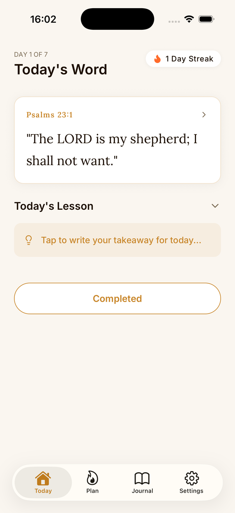
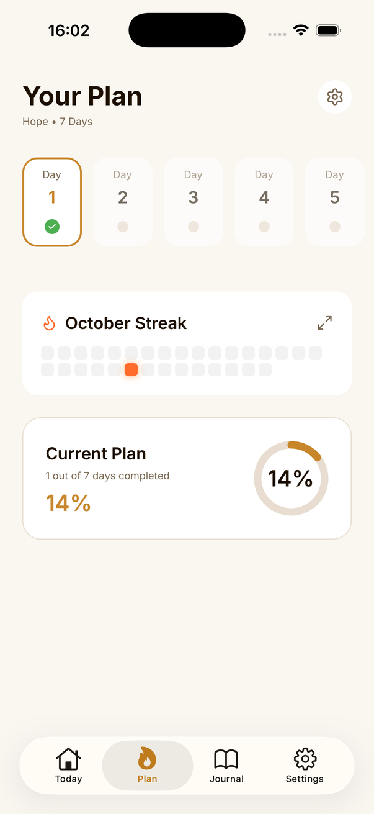
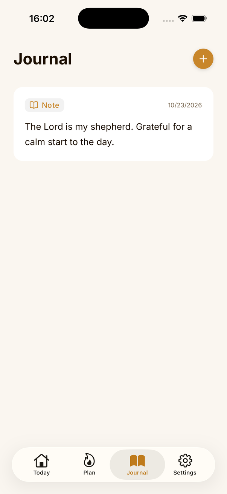
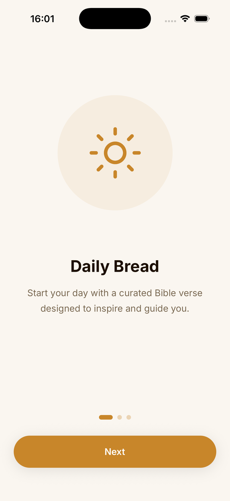
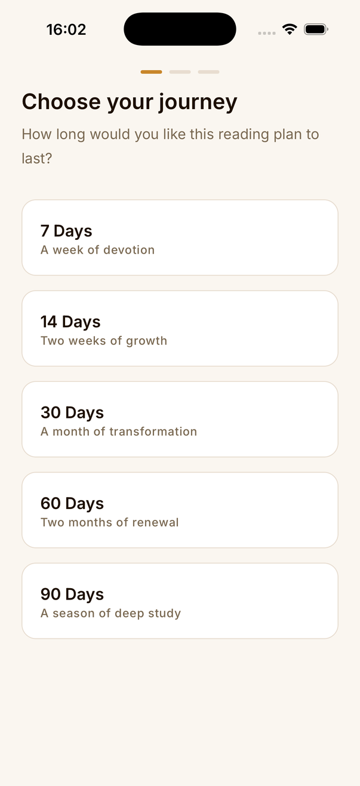
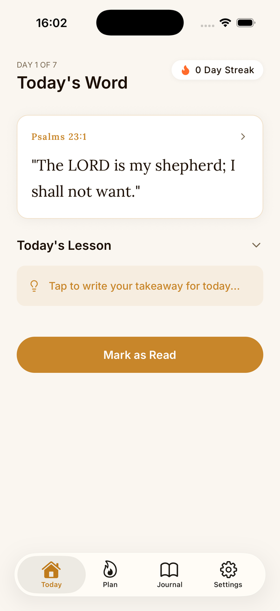
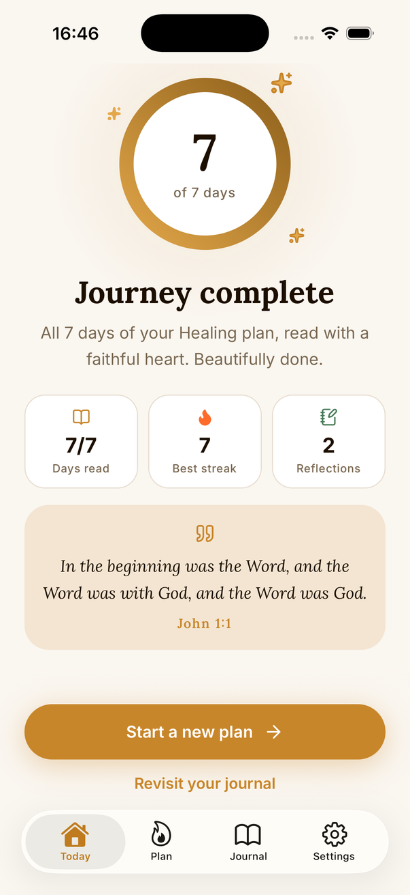
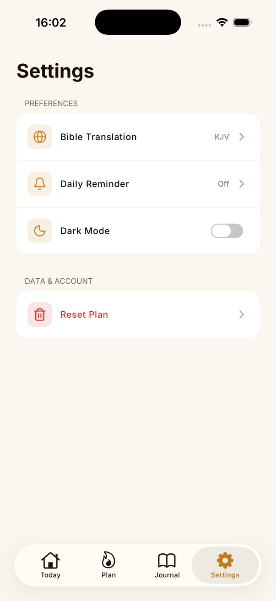
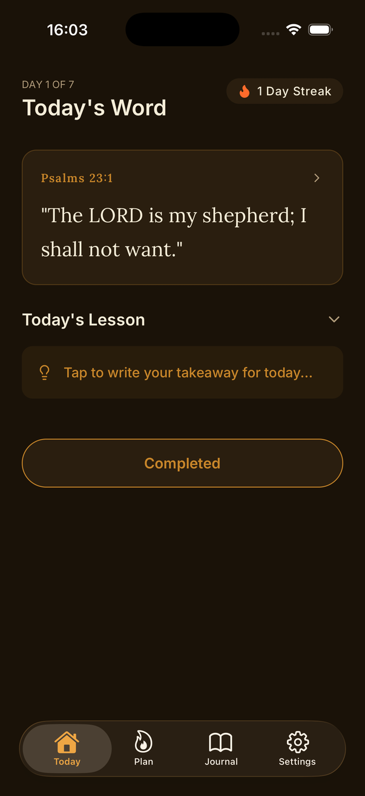

# Eword

A calm, offline-first daily Bible reading app. Pick a theme and a length, and Eword builds a reading plan, one verse a day, with a reminder, a streak, and a journal to capture your reflections.

Built with Expo and React Native. No accounts, no backend, no tracking: everything stays on your device.

<p align="center">
  
  
  
</p>

## Features

- **Themed reading plans.** Choose a theme (General, Hope, Faith, Strength, Peace, Wisdom, Gratitude, Healing) and a length (7, 14, 30, 60 or 90 days, or a custom number).
- **Today's Word.** One verse a day, set in a serif reading face, with a lesson section and a one-line takeaway you write yourself.
- **Streaks and progress.** A monthly heat map, a progress ring, and a reading streak.
- **Journal.** Free-form notes and per-day reflections, with a saved version history for each entry.
- **Daily reminders.** Local notifications at a time you pick, either as a normal notification or as an alarm-style sound.
- **Read aloud.** Text-to-speech for the verse, using the best English voice installed on the device.
- **Share cards.** Render a verse as an image and share it.
- **Light and dark themes**, plus milestone celebrations at 7, 14, 21, 30, 60 and 90 days.

## Screenshots

| Onboarding | Plan setup | Verse |
| :---: | :---: | :---: |
|  |  |  |

| Today | Plan | Journal |
| :---: | :---: | :---: |
|  |  |  |

| Plan complete | Settings | Dark mode |
| :---: | :---: | :---: |
|  |  |  |

## Tech stack

| Area | Choice |
| --- | --- |
| Framework | [Expo](https://expo.dev) SDK 57, React Native 0.86, React 19, TypeScript |
| Navigation | [Expo Router](https://docs.expo.dev/router/introduction/) (file-based, typed routes) with native tabs |
| Persistence | `expo-sqlite` for plans, reading history and journal; `react-native-mmkv` for small synchronous settings |
| State | React Context + `useReducer` (no external state library) |
| Animation and gestures | `react-native-reanimated`, `react-native-gesture-handler` |
| Notifications | `expo-notifications` (local, scheduled on device) |
| Media | `expo-speech` (read aloud), `react-native-view-shot` + `expo-sharing` (share cards) |
| UI | `lucide-react-native` icons, `react-native-svg`, Lora (verses) and Inter (UI) via `@expo-google-fonts` |
| Build | EAS Build, React Compiler enabled |

## Getting started

Requirements: a current Node.js LTS, and Xcode (iOS) or Android Studio (Android) for native builds.

```bash
git clone <your-fork-or-this-repo-url>
cd bible-app
npm install

# Build and run a development build
npm run ios        # or: npm run android

# Later, just start the dev server
npm start
```

The app uses native modules (SQLite, MMKV, notifications, native tabs), so it needs a **development build**; Expo Go is not enough.

### Scripts

| Script | What it does |
| --- | --- |
| `npm start` | Start the Expo dev server |
| `npm run ios` / `npm run android` | Build and run the native app |
| `npm run web` | Start the web target |
| `npm run fetch-verses` | Regenerate `src/content/verses.json` from bible-api.com (KJV); writes nothing unless every verse downloads |

## Project structure

```
src/
  app/            Expo Router routes
    (onboarding)/   welcome + plan setup wizard
    (main)/         Today, Plan, Journal, Settings tabs
    verse/[day]     verse detail, read aloud, share
    note/[id]       note editor with version history
  components/     UI building blocks (verse card, heat map, progress ring, ...)
  constants/      colors, typography, themes and durations
  content/        verses.json, the bundled verse library
  context/        AppContext: active plan state hydrated from SQLite
  db/             schema + versioned migrations, queries
  hooks/          theme, streak, notifications
  services/       planEngine (plan generation, streaks), shareService
  utils/          MMKV storage wrapper
scripts/          verse fetcher
```

## Key decisions

**Local-first, no backend.** A devotional app holds private reflections, so nothing leaves the device: no sign-in, no sync service, no analytics. It also makes the app work fully offline and removes any server cost, which suits an open-source project anyone can fork and run.

**SQLite for data, MMKV for settings.** Plans, reading history and journal entries are relational (a plan has days, days have journal entries) and benefit from foreign keys, `UNIQUE(plan_id, day_number)` constraints and cascading deletes. Settings such as reminder mode and dark mode are read at startup or inside notification handlers, where a synchronous key-value store is simpler than awaiting a query.

**Versioned migrations.** `src/db/schema.ts` tracks applied versions in a `schema_migrations` table and runs only the new ones. Adding a column (journal version history was added this way) is a new entry in the list, so existing installs upgrade in place without losing data.

**Deterministic plan generation.** `planEngine.ts` orders the verses with a seeded PRNG (mulberry32) whose seed is a hash of the theme and start date. The same theme and start date always produce the same plan, so a plan can be rebuilt without storing extra state. Each pass lists the theme's verses first and then the rest of the library, so a theme with few verses is topped up with other verses instead of repeating, and no verse repeats until the whole library has been used.

**Calendar-date day math.** The current day number is computed from local calendar dates converted to UTC midnights, not from elapsed milliseconds, so daylight-saving changes cannot shift a day. The app also refreshes the current day when it returns to the foreground.

**A forgiving streak.** One missed day does not break a streak; two in a row do. Today, which is still open, never counts as a miss. The rule lives in a single pure function (`calculateStreak`).

**Bundled, public-domain text.** Verses ship as `verses.json` in the King James Version, which is public domain, so there are no licensing or API-key concerns. Translations are modelled in the schema (`translation` column) so more can be added later.

**Context + reducer instead of a state library.** The app has one piece of global state, the active plan, hydrated from SQLite. `useReducer` keeps updates explicit and testable without adding a dependency.

**Native tabs and platform feel.** Navigation uses Expo Router's native tab bar so it picks up the platform's look, including the glass effect on recent iOS. Typography pairs a serif (Lora) for scripture with a clean sans (Inter) for the interface.

**Design tokens.** Colors, type scale and themes are centralized in `src/constants`, with a warm gold and forest green palette and parallel light and dark values.

## Status and roadmap

Eword is early. Things to know before you build on it:

- The library currently has **41 curated KJV verses**. The devotional `lesson`, `key_takeaway` and context fields in `verses.json` are **placeholders** waiting for real content. Contributions are very welcome here.
- Only the **KJV** translation is available.
- Plans longer than 41 days repeat verses, because the library is finite. More verses are the fix.
- Only **one active plan** is supported at a time. Support for two simultaneous plans is designed but not built.
- Reminders are a repeating daily notification. The app cancels it the next time it is opened after your plan ends, so if you never open the app again you will keep getting the reminder until you turn it off in system settings.
- Screenshots above were captured on an iOS simulator. Android configuration is included but has not been verified here.

## Contributing

Issues and pull requests are welcome. Good first contributions: writing lessons for the verses, adding verses (see `scripts/fetch-verses.js` for the format), adding translations that are legally redistributable, and Android testing. Please make sure `npx tsc --noEmit` passes before opening a PR (one pre-existing error in `app-tabs.web.tsx` is known).

## License

See [LICENSE](LICENSE).
